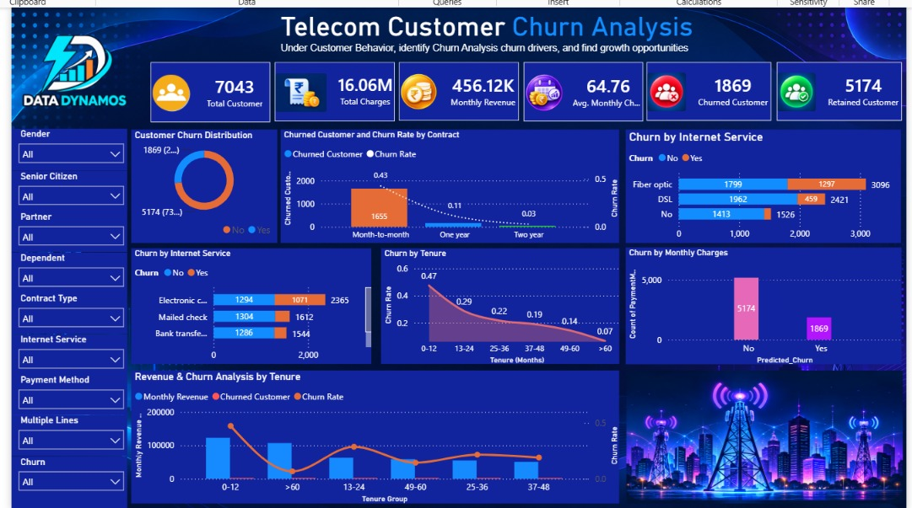

# 📊 Telecom Customer Churn Prediction System

## 🚀 Project Overview

Customer churn is one of the biggest challenges faced by telecom companies. This project uses Machine Learning techniques to predict whether a customer is likely to leave the telecom service based on customer demographics, subscription details, and billing information.

The system helps businesses identify high-risk customers and take proactive retention measures.

---

## 🎯 Objective

Develop a machine learning model that can predict customer churn with high accuracy and provide insights into the factors influencing customer retention.

---

## 📂 Dataset

Dataset: Telco Customer Churn Dataset

Features include:

- Gender
- Senior Citizen
- Partner
- Dependents
- Tenure
- Phone Service
- Internet Service
- Online Security
- Tech Support
- Contract Type
- Payment Method
- Monthly Charges
- Total Charges
- Churn

Target Variable:

- Churn (Yes / No)

---

## 🛠️ Technologies Used

### Programming

- Python

### Libraries

- Pandas
- NumPy
- Matplotlib
- Seaborn
- Scikit-Learn
- Joblib
- Streamlit

### Database

- MySQL

### Visualization

- Power BI / Streamlit Dashboard

---

## 🔄 Project Workflow

1. Data Collection
2. Data Cleaning
3. Exploratory Data Analysis
4. Feature Engineering
5. Data Preprocessing
6. Model Building
7. Model Evaluation
8. Hyperparameter Tuning
9. Deployment using Streamlit

---

## 📈 Exploratory Data Analysis

Key visualizations performed:

- Churn Distribution
- Gender Distribution
- Internet Service Analysis
- Contract Type Impact
- Monthly Charges Distribution
- Correlation Analysis

---

## ⚙️ Feature Engineering

Performed:

- Label Encoding
- One-Hot Encoding
- Feature Scaling using StandardScaler
- Handling Missing Values

---

## 🤖 Machine Learning Models

Implemented:

### Logistic Regression

- Classification Model
- Baseline Model

### Decision Tree Classifier

- Tree-Based Algorithm
- Easy Interpretation

### Random Forest Classifier

- Ensemble Learning
- Best Performing Model

---

## 📊 Model Performance

| Model | Accuracy |
|---------|---------|
| Logistic Regression | 80% |
| Decision Tree | 73% |
| Random Forest | 81% |

*(Replace with your actual results)*

---

## 📉 Evaluation Metrics

- Accuracy Score
- Confusion Matrix
- Precision
- Recall
- F1 Score
- ROC Curve
- AUC Score

---

## 📸 Application Screenshots

### Dashboard


(DASHBOARD 2.jpeg)

### Prediction App


---

## 🚀 Streamlit Deployment

Run locally:

```bash
python -m streamlit run app.py
```

---

## 📌 Future Improvements

- Hyperparameter Optimization
- XGBoost Implementation
- Real-Time Prediction


